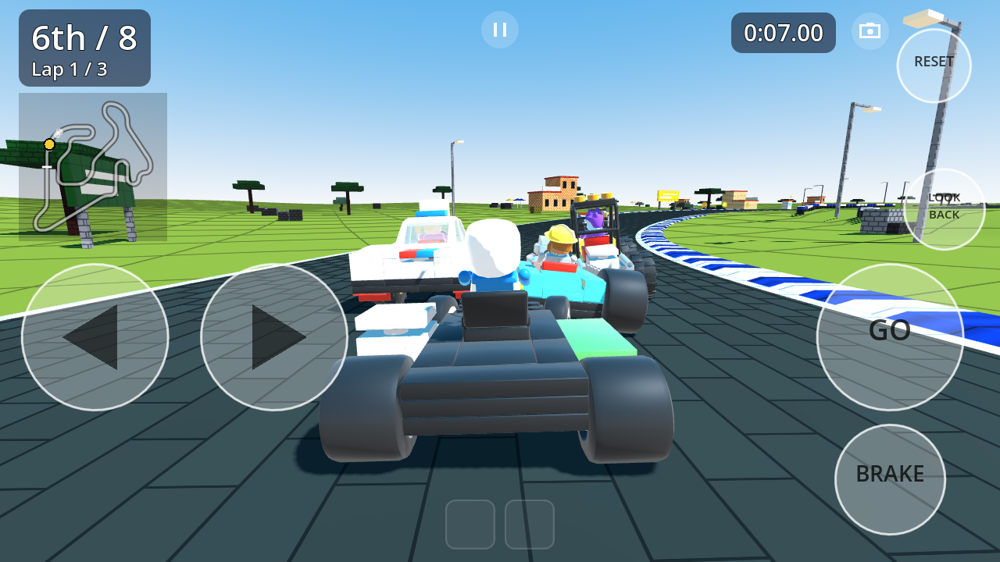
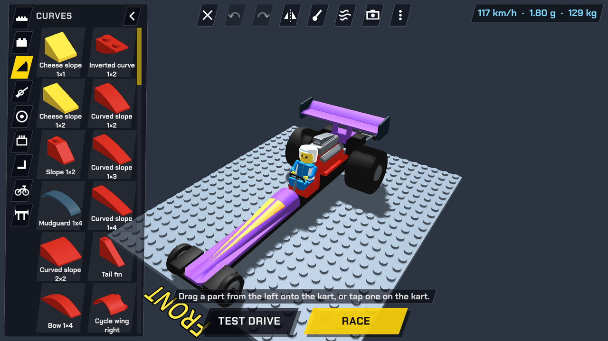
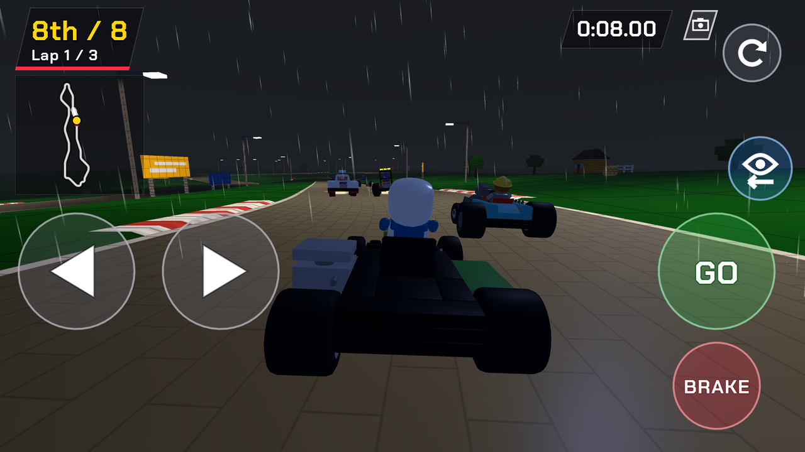
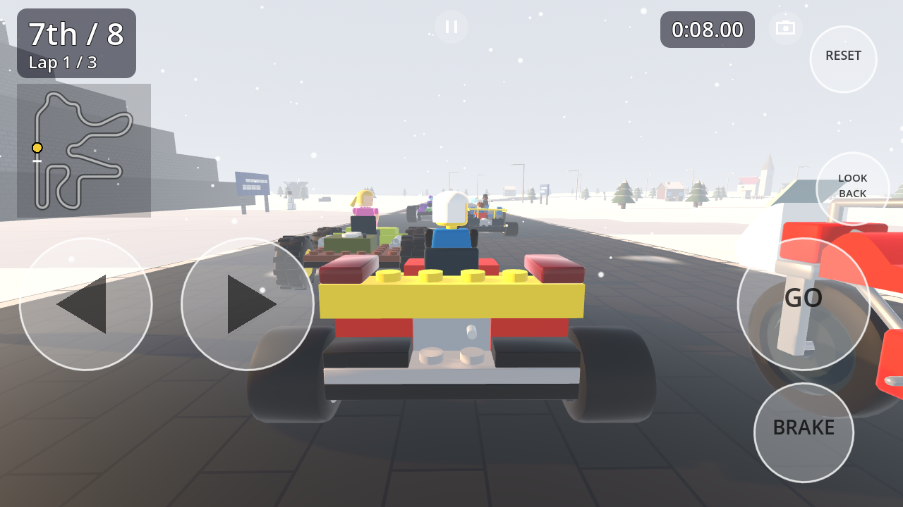
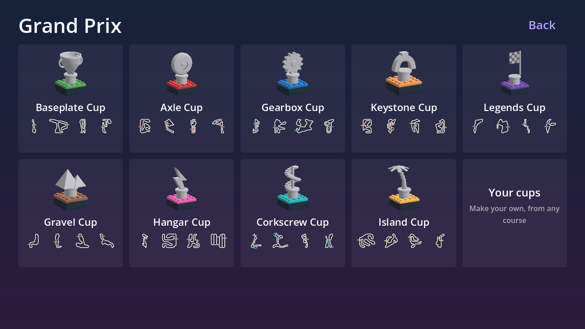
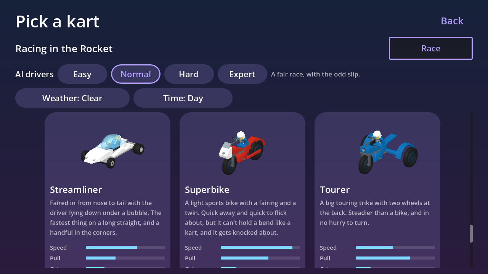
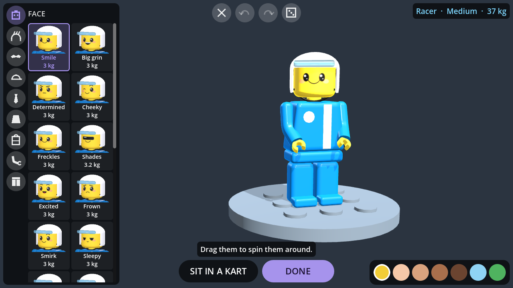
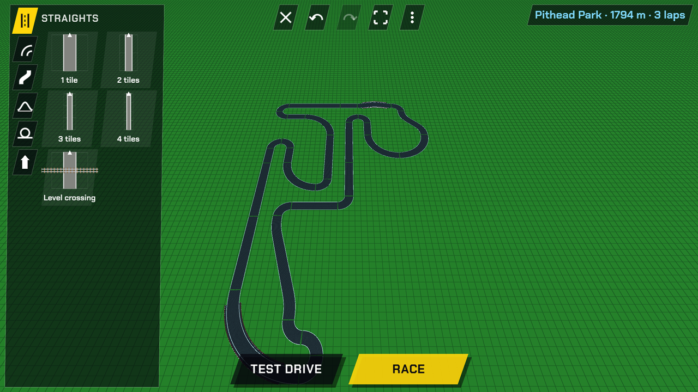

# SnapRacers

SnapRacers is a physics based kart racing game I put together for my son. It needs Android 8.1 or newer, and you can play it in a browser too.

Build your kart from blocks and race it, changing it bit by bit until you've got the fastest kart you can make.
The parts you use matter, each one adds drag, weight or power, so every piece trades one thing for another. Crashes knock parts off,
at least until you hit the reset button, which slows you down a little.

Race in Grand Prix cups against AI drivers of different skill, or race your friends on a split screen or online.
Race on the built in courses or make your own in the track editor, and put them together into your own cups.

It's playable now, but there will be plenty of rough edges until they're tested out.

Cheers,<br>
Dan

---

## Screenshots

<table>
  <tr>
    <td align="center"></td>
    <td align="center"></td>
  </tr>
  <tr>
    <td align="center"></td>
    <td align="center"></td>
  </tr>
  <tr>
    <td align="center"></td>
    <td align="center"></td>
  </tr>
  <tr>
    <td align="center"></td>
    <td align="center"></td>
  </tr>
</table>

---

## What's in it

### The garage

The kart fills the screen and everything else floats over it.

- Drag a part from the drawer onto the kart and it snaps on wherever its studs, clips, pins or axles fit. Dots show where it can go, and tapping one puts it there.
- Tap a part on the kart to move, turn, flip, slide, copy or delete it, or to change which way it faces.
- Mirror puts every part down on both sides at once.
- Paint any part in sixteen brick colours.
- Undo and redo anything, and save as many karts as you like. You can start from any of the stock karts too.
- The card in the corner shows top speed, pull, cornering, control, off-road grip, weight and drag, and where most of the drag comes from.
- The wind button shows the air over the kart, with each square tinted by how much drag it makes.
- You can take it straight out for a test drive.

### 289 parts

I modelled most of the parts for the game in `tools/parts`, and they join by their studs, clips, pins and axles like real bricks do.

| | |
|---|---|
| Plates | Forty-four, from 1x1 to long and wide chassis plates and kart axle plates, with smooth and pinstriped tiles, round plates, a grille and wedge plates for a pointed nose. |
| Bricks | Fifteen, from 1x1 to 2x6, with a tall brick, a race number brick, round bricks, a bracket, a brick with a stud on its side, a headlight brick and a heavy ballast brick to keep the kart low. |
| Curves | Thirty-seven: slopes, curved and inverted slopes, nose cones, bows, wheel arches, mudguards, a racing nose with or without headlights, an engine cowl, a tail fin, wheel fairings, side pods and a ram plate that knocks other karts' parts off. Face them forward and the air slides over them, or turn them around to smooth the back. |
| Car bodies | Thirty-two: bonnets plain and striped, car and truck cabs, smooth wheel arches, a formula nose, an engine cover with a fin, a scoop, a dragster body and tub sides with flames, a hot rod grille, roll hoops, bars and cages, a bull bar, mudguards and mud flaps, a wheelie bar and exhausts. |
| Rods and joints | Twenty-five: bars, clips and handles, beams with holes, pins and axles, axle plates, hinges and ball joints. |
| Wheels | Twenty-eight, from tiny wheels to monster truck wheels, with kart, dragster, truck, quad, scooter and motorbike wheels. Slicks grip the road best and hate grass, knobbly and studded tires bite into grass, dirt and ice, balloon tires float over sand and curbs, and skinny wheels roll the furthest. |
| Engines | Fourteen: small and big engines, a micro engine, a rotary, a flat four, a twin, a hybrid, two electric motors, a diesel, a V8, a blower V8, a jet and pedals. Each one sounds different. |
| Cockpit | Twenty-five: seats (upright, racing, bucket and lay-down), a steering wheel, a racing wheel, handlebars, a yoke, a tiller, windscreens and canopies, lights (round, tail, amber, a light bar, spotlights and a big round lamp) that come on by themselves when it's dark, a mirror and an exhaust. |
| Bikes, trikes and quads | Fifty-nine: frames for sports bikes, dirt bikes, choppers, scooters, trikes and quads, with their bodywork, forks, a swingarm, tanks, saddles, bars, footpegs, fairings, cycle wings, a sissy bar and quad fenders. |
| Wings | Ten: spoilers, a ducktail, front wings, one with endplates, and big rear wings, single and double. |

### Air and seating

The shape of the kart decides its drag. From the front, a flat brick face catches all the wind and a slope or nose cone lets it slide past. The driver catches wind too unless there's a windscreen in front of them. Open wheels churn up a lot of it, so fairings in front of them help the most.

How the driver sits matters too. Lying down keeps them out of the wind but they steer more slowly. The steering has to be right in front of the seat, and every stud they have to reach for it slows their hands.

### Stock karts, trucks, bikes and quads

If you'd rather not build, you can pick one of the 24 stock karts, trucks, bikes, trikes and quads before any race. The AI drivers race in them too, each getting one at random for a race or a whole Grand Prix. They're all within about ten percent of each other around a lap, they just get there in different ways.

| | |
|---|---|
| Kart Kid | A proper little go-kart, light and nippy with the engine beside the seat. Easy to learn on. |
| Redline | A formula racer with open wheels and wings at both ends. Light and quick through the fast corners. |
| Big Block | A muscle car with a big engine under a long striped bonnet. Heavy and strong, and quick once it gets going. |
| Oval Ace | A stock car with a roof over the driver and a spoiler on the boot. Steady and easy to drive. |
| Gravel Rat | A rally car on knobbly tires with four lamps on the bonnet. At home on dirt and gravel. |
| Night Shift | An endurance racer with the driver lying down under a bubble. Fast and smooth. |
| Quarter Mile | A dragster with a blower V8, huge slicks and a wheelie bar. Unbeatable in a straight line, and it hates corners. |
| Flathead | A hot rod with a blower V8 out in the open. Loads of pull, and a bit of a handful. |
| Sandhopper | A dune buggy with a roll cage. Happiest off the road, in sand and on grass. |
| Volt | An electric racer with wings at both ends. Quick away and easy to drive. |
| Crusher | A monster truck that rolls over anything, but it's tall, so take the corners steady. |
| Long Haul | A big rig without its trailer. Slow to get going, hard to stop, and it shoves everyone out of the way. |
| Desert Pro | A desert racer on big knobbly tires. Fast over the rough stuff and happy on the road too. |
| Six Pack | A truck with two axles at the back. It grips like nothing else, but it's slow to turn. |
| Streak | A superbike, low and faired in. Very fast, but it can't hold a bend like a kart and it gets knocked about. |
| Scrambler | A dirt bike that rides over grass and bumps better than anything, but it's slow to turn on tarmac. |
| Zippy | A little scooter, quick off the line, but it runs out of puff on the straights. |
| Long Fork | A chopper with its fork way out in front. Fast on the straights, but it turns like a bus. |
| Twin Nose | A trike with two wheels in front. It holds a bend nearly like a kart and still leans into it. |
| Sunday Trike | A chopper trike with a big rounded body on the back. Steady and comfy, but slow to turn. |
| Tiddler | A little electric trike with a box on the back. Slow but very steady, and easy for anyone to drive. |
| Zipper | A sport quad that sits flat in the bends like a kart and handles grass better than one. |
| Mudlark | A mud quad up on big knobbly wheels. Slow on tarmac but happy anywhere off it. |
| Flat Track | A low racing quad on wide wheels. Sharp in the bends, but it doesn't like the grass. |

### Power-ups

Every 400 m or so there's a row of giant see-through gold studs across the road. Drive through one and you get a power-up on one of your two gadget buttons, so you can hold two at once. What you get is random, but the further back you are the better your chances of a strong one, and the leader gets more of the ones for keeping others behind.

| | |
|---|---|
| Turbos | A turbo, a big turbo that lasts longer, and a triple turbo with three goes. |
| Tow rope | Latches onto the kart ahead and pulls you along behind it for three seconds, then lets go with a burst. |
| Bricks, walls, marbles and spikes | Drop a pile of bricks, a brick wall across the road, a scatter of round bricks that roll under the wheels, or a spike trap that slows karts and knocks parts off, behind you for whoever's following. |
| Shockwave | Shoves every kart near you away hard, and knocks parts off any close by. |
| Cannon | Fires a brick straight ahead, and a homing brick follows the road to the kart in front. Whoever it hits loses a part. |
| Shield | Nothing can knock your parts off for four seconds. |
| Repair kit | Puts back everything you've lost, without the reset slowdown. |
| Ghost | For three seconds you go straight through karts, bricks and traps. |
| Lightning | Every kart ahead of you slows right down for two seconds. |

### Drivers

You build your driver from a face, hair, facial hair, headgear, something around the neck, a torso, something on the back, arms and legs, each in its own colours. There are at least twenty of each, from caps, crowns and space helmets to moustaches, capes, shells and wings. What they wear decides how heavy they are, and a heavier driver makes a steadier kart. The seven AI drivers are built the same way.

They're little brick figures, a bit cuter, with bigger heads, shiny eyes and rosy cheeks. They blink, look over at karts beside them, look surprised when they get hit, grin when they pass someone and look cross when they get passed. The winner throws their fists in the air. On the driver screen they fidget, look around, wave now and then and hop when you try something new on them.

### Track editor

You build courses like a slot car set. Each piece you tap clicks onto the end of the road: straights, bends in three sizes, slants and S bends, humps, ramps and climbing bends for bridges, a jump, a loop, wall rides, banked sweepers and bends with a shortcut. Tap a piece of road to take it out, change it to dirt, grass, sand or ice, add or take off walls, or add pieces after it.

Close it up adds the fewest pieces it takes to bring the road back around to the start, and the card in the corner says what's still stopping it being raced. Pick a theme for the ground, colours and trees and how hilly it is, and put landmarks like windmills, castles, rockets and lighthouses wherever you like.

Saving moves the start line onto your longest straight, and the course shows up in the lists for every kind of race, with its own records. Each course is one file, so when you host a game online everyone gets it.

### Sharing courses and cups

You can share any course or cup of yours as a code or a file. The code is short enough to paste in a message (a course is about 400 characters). On a phone both go through the share sheet, so you can send them in any chat app, email or Drive. On a computer the code is copied and the file saved where you like, and on the web the file's downloaded.

To add one you've been sent, use Add a course or Add a cup and paste the code or open the file. A cup brings its own courses with it, so you can race each of them on their own too. Something you've already got isn't added twice. If you race someone else's course or cup online, Keep in the lobby adds it to yours.

### Courses

Every course is based on a real circuit, with laps of 1.6 to 1.9 km and a road wide enough for three karts through a bend. They're made of track pieces snapped together on a grid, with crests, jumps, bridges, a loop and plenty of scenery.

- Kart circuits are as big for the karts as the real ones are for real karts. The famous race tracks in the Legends Cup are shrunk down to the same lap size.
- The Gravel Cup is rallycross, on real rallycross circuits that are part tarmac and part gravel.
- The Hangar Cup is indoors, on real indoor kart tracks made bigger, in halls with barriers all the way around and rows of lights overhead. One goes over itself on an upper deck.
- The Corkscrew Cup is traced from real roller coasters, up high on coaster supports, with big drops, airtime hills and corkscrews that turn you upside down.
- The Island Cup is by the sea on four islands, with the beach and boats out on the water beside you.

The road runs out onto grass that slows you down, and there are only walls where you'd fall off. The corners have red and white curbs you can ride, but at speed they bounce your wheels into the air. Where two bits of road run close together there are soft tire stacks between them. The ground rolls in gentle hills, a little by the lakes and a lot in the mountains.

The scenery breaks. Drive through a tree, a fence or a billboard and it comes down in pieces, and a crash into a house or the grandstand knocks a hole in it. The loose bricks stay where they land until the race is over and you can push them about, so the places people crash fill up with rubble. A hard hit on a tire stack knocks its top tires off but the bottom ones stay, so you still can't cut across.

There's a crowd too. Little brick figures fill the grandstands and stand along the fence at some corners, and they jump up and wave their arms as you go by. Windmills and wind turbines turn, flags wave, the big wheel and the carousel go around, cranes swing and boats rock on the water.

| Cup | Courses |
|---|---|
| Baseplate | Peach Pit, Trulli Turns, Lemon Lake, Pithead Park |
| Axle | Delta Dash, Bucketwheel Bend, Foundry Flats, Amber Arc |
| Gearbox | Timberline, Frostbite Forest, Dune Drift, Whistlestop Woods |
| Keystone | Windmill Ridge, Launchpad Loop, Magma Mile, Castle Keep |
| Legends | Royal Run, Dry Lagoon, Sakura Swirl, Rouge Ridge |
| Gravel | Menhir Meadow, Oast Hill, Devil's Dust, Pine Hill Leap |
| Hangar | Neon Nights, Hairpin Hall, Bohemian Bends, Spark Deck |
| Corkscrew | Serpent Summit, Lakeshore Plunge, Red Rocket, Twister Pines |
| Island | Windsurf Way, Coral Cove, Blue Lagoon, Penguin Point |

### Racing

- Grand Prix is nine cups of four races each, for points and trophies. From the second race on, the leader starts at the back. All the cups are on one screen, each with its own brick trophy and the layouts of its courses. A trophy's grey until you finish in the top three, then it's gold, silver or bronze.
- You can make your own cups of 2 to 8 races from any courses and race them as a Grand Prix. A cup is one file with its courses in it, so it can be shared.
- Single race is one race against the AI on any course. Pick a cup, then one of its courses.
- Time trial is you against the clock, with your best times kept.
- Practice lets you drive any course on your own for as long as you like.
- Two players can share one phone, side by side in landscape or face to face in portrait with the phone flat between you. Each player picks a kart and gives their name in turn, and one map sits on the line between the halves. From the Multiplayer menu you can race one course or a whole Grand Prix together against the AI.
- There are six camera views: close and far chase, first person from your driver's eyes (your own parts in the way go see-through), a bumper cam, overhead and TV cameras beside the track. Hold look back to see who's coming. After the finish the camera circles your kart and the AI drives you home.
- To slide, hold the gas and brake together while steering, or slide your thumb from GO down onto the brake and back up. Keep the gas on and keep steering into the bend and the slide holds, with the tail out further the harder you steer. Straighten up or let go of the gas and it grips again. A held slide keeps its speed around a hairpin better than braking for it, but the longer you hold it the more it scrubs off. Hold it at least half a second and straighten up out of it with the gas still on and you get a little turbo, longer the longer you held it. Expert drivers slide too.
- The button in the corner, or Start on a controller, opens a menu in races. In a race on your own it pauses everything, and in split screen each player has their own while the race carries on.
- There are four AI levels, picked before a race or a cup. Easy drivers take it gently, slip up now and then and wait for you. Expert drivers are right on the limit. Trophies are kept for each level.

### Weather and time of day

Each race has its weather and time of day, picked beside the AI's level or left to chance to suit the course. A course can have its own set in the track editor.

- It can be morning, day, evening, dusk or night. The sun moves and colours everything, and at night a dimmer moon casts fainter shadows.
- Rain brings grey skies and a dark, shiny road that grips less, with puddles that grip less again and drag.
- Snow covers the ground and everything on it. The road's been cleared but it's wet and slippery.
- Fog hides the distance, a thunderstorm brings heavy rain with lightning and thunder, and on sandy courses a dust storm turns everything tan.
- Lamp posts line every outdoor course and come on by themselves when it's dark, and so do the lights on a kart. Headlights light the road ahead and tail lights shine when you brake.
- Left to chance, snowy courses mostly get snow, deserts get dust storms and never rain, and beaches are mostly sunny. Halls are always the same. A time trial left to chance is a clear day.
- Outdoors only clear daytime runs count toward records, and indoor runs always count. Other conditions still show your race and lap times.
- The AI drives to suit, and online everyone races in the same weather with the same puddles.

### Graphics

Slower phones can turn the graphics down in Settings, under Display. Medium and Low draw the race at a lower resolution, with the menus and the race's words still sharp. They cut the shadows short or leave them out, along with some far off scenery, the crowd and the studs, and there's less rain and snow. Nothing you could drive into is ever left out, so a race is the same whatever anyone picks.

### Controllers and keys

Everything works with a controller or the keys as well as touch: the menus, races, the garage, the driver screen and the track editor. In Settings each player picks their own controller and sets their own keys and buttons by tapping one and pressing the new one. Power-ups are on RB and LB to start with. A Switch controller's buttons go by what's printed on them, and you can pick the Xbox or Switch layout in Settings. To type a name with a controller, press A on the box for a keyboard on the screen. X deletes, Y is a space and Start is done.

### Online

You can race people on other phones, up to eight karts, with AI drivers in the empty places if the host wants them. The host picks one race or a whole cup and it's sent to everyone. Two players on one phone can go online together on a split screen.

- On the same Wi-Fi, one phone hosts and the game shows up on the others by itself.
- With a hotspot, turn on one phone's hotspot, join it with the others and host on that phone.
- Wi-Fi Direct needs no router or hotspot. One phone hosts over Wi-Fi Direct and the others use Find Wi-Fi Direct games.
- Bluetooth is for two or three phones with no Wi-Fi at all. Pairing them first makes it quicker.
- A SnapRacers server runs races by itself, on your network or on the internet, in Docker with an admin page. Browsers can join one too, and that's the only way to race online from the web version. See [server/README.md](server/README.md).

"How do I connect?" at the bottom of the online screen goes through all of it.

### Sound

Everything you hear was made for the game by a little synthesizer in `tools/sound`. Nothing is recorded or downloaded.

- Each kind of engine has its own sound, from the buzzy little kart engine to the clattering diesel, the burbling V8, the whining electric motor and the roaring jet. You can rev yours on the grid.
- Tires squeal when you slide, grass and dirt rumble, and the wind picks up as you go faster.
- There are knocks and crashes, bricks clattering off, every power-up, the countdown, laps, the finish and the clicks in the menus and the garage.
- There's a laid back tune for the menus and one for each cup. I wrote them note by note and the synthesizer plays them.

Music and effects each have their own volume in Settings.

---

## Installing

The easiest way to install SnapRacers and keep it up to date is through my F-Droid repo:

[https://hunke.ws/fdroid/repo](https://hunke.ws/fdroid/repo?fingerprint=80438B253C257BCCE05CDCB9E3AC9B6174C2250659962B14FCBE7F32FD42D53E)

Then search for SnapRacers in F-Droid, and it'll offer each new version as an update.

You can also download the APK from the [Releases](https://github.com/roge-rm/SnapRacers/releases) page and sideload it. There's a 32-bit build too, for older phones and tablets that can't run the usual one. F-Droid picks the right one by itself.

## Playing in a browser

You can play it in a browser at [hunke.ws/fdroid/play/snapracers](https://hunke.ws/fdroid/play/snapracers/). It's the same game, and your karts, drivers, courses and records are kept in the browser. Two players can share a keyboard or plug in controllers. It needs a browser with WebGL 2, which any recent Chrome, Edge, Firefox or Safari has.

## Building

SnapRacers is made with Godot 4.7.2, using the Compatibility renderer and Jolt physics. The build scripts expect a copy of Godot in `tools/godot`, which isn't in the repo:

- `tools/godot/Godot_v4.7.2-stable_linux.x86_64`, with an empty `._sc_` file beside it so it keeps its settings in `tools/godot/editor_data`
- the 4.7.2 export templates in `tools/godot/editor_data/export_templates/4.7.2.stable`
- the Android SDK and Java 21, set in the editor settings under Export › Android

```sh
tools/build-engine.sh             # our own cut down engine (once, and again for a new Godot)
tools/build-engine.sh --release   # the same, fully optimised, for a release (much slower)
tools/build-android.sh            # the phone APK (arm64)
tools/build-android.sh --install  # the emulator APK (x86_64), installed on the running emulator
tools/build-engine.sh web         # our own cut down engine for the web page
tools/build-web.sh                # the web page, in build/web
tools/build-web.sh --serve        # the same, served over HTTPS on port 8060 to try it
tools/build-plugin.sh             # the Android network plugin (build-android.sh does this when it's needed)
tools/build-server.sh --run       # the dedicated server, to run on this PC (Docker's in server/)
```

`tools/build-engine.sh` builds Godot from source with only what the game uses (the list is in `tools/engine/profile.py`), which makes the APK a lot smaller. It needs the Android NDK version Godot asks for and `uv` for installing scons. The finished engine goes in `tools/godot/custom` and the Android build puts it into the APK, so it only needs building again for a new Godot or a change to the list. Without it, the build uses the stock engine.

The web page is built without threads so it runs on any web host. Its engine needs [Emscripten](https://emscripten.org), which the build looks for in `~/.local/share/emsdk` or wherever `EMSDK` says.

The Android network plugin in `android-plugin` is a little Kotlin library for finding games with NSD, Wi-Fi Direct and Bluetooth. It's built with the Gradle from Godot's Android build template, and `addons/snapracers_net` puts it into the APK.

The phone APK is signed with my release key, which lives beside the project in `../Keys`. Anywhere else it's signed with the Android debug key.

Everything the builds make goes in `build/`, which git ignores. The engine keeps its compile cache there too.

| | |
|---|---|
| Minimum Android | 8.1 (API 27) |
| Engine | Godot 4.7.2, GL Compatibility renderer, Jolt physics |
| ABIs | `arm64-v8a` for phones (a release build), `x86_64` for the emulator (a debug build) |
| Code | GDScript in `scripts`, with parts, karts, drivers and courses as JSON in `data` |
| Sound | Made by `tools/sound/make_sounds.py` into `sound` (see `tools/sound/README.md`) |

`tools/stock-karts` builds the stock karts and times them against each other, and `tools/track-design` turns real circuits into track pieces. Each has its own README.

## Testing

The tests run headless on the computer. They take a while, since some race in real time.

```sh
tools/run-tests.sh
```

They check things like:

- a simple test kart settles on its wheels, gets up to speed, turns, brakes and resets (`drive_test`)
- the building rules (`design_test`)
- every part can be built and turned, and shapes, windscreens, seats, jets and tires do what they should (`parts_test`)
- a gentle bump costs nothing, a crash at full speed knocks parts off and a reset puts them back (`damage_test`)
- small scenery comes down whole, buildings only where they're hit, tire stacks keep their bottom tire, a kart driving into something small knocks it down and keeps going, flags flap until they're knocked down and the crowd cheers as a kart goes by (`damage_world_test`)
- every course closes into a loop without running into itself (`track_test`)
- a fast kart sticks to the loop all the way around and a slow one drops off (`loop_test`), and the same on a corkscrew (`corkscrew_test`)
- bikes and trikes stay upright, lean into bends the right way and don't tip over in a hard turn (`bike_test`)
- every power-up does what it says, the boxes hand them out and the karts at the back get the strong ones more often (`gadget_test`)
- a faster kart gets past one it's racing wheel to wheel without their wheels hooking together (`wheels_test`)
- the AI steers around a brick wall across its line, and resets when it loses a wheel (`ai_wall_test`)
- the graphics setting draws less on lower levels, and everything a kart could hit stays just where it is (`graphics_test`)
- left to chance, the weather and time of day suit the course and come out the same for the same seed, a picked one sticks, puddles are the same for the same seed, and karts grip less in the rain, less again in snow and least through a puddle (`weather_test`), and the AI gets around a snowy course (`race_test`)
- gas and brake together slide the kart around a bend tighter than steering alone, a slide held on the gas keeps going with the tail out steadily without spinning, and it grips again once you straighten up, with a little turbo for holding it (`drift_test`)
- drivers hold the steering wheel, and every hat, hairdo, beard and back piece is joined on without poking through anything (`character_test`)
- the garage, the menus and every mode, including a whole Grand Prix and two players on one phone (`garage_test`, `menu_test`, `modes_test`, `split_test`)
- the track editor used the way a player would, and what stops a course being raced (`editor_test`, `course_test`)
- a course or cup goes to a share code and back the same, even split over lines in a message, a tampered one is turned away, and adding one never makes a second copy (`sharing_test`)
- each player's keys and controller buttons, the menus with a controller, typing with one, and the menu in a race (`bindings_test`, `focus_test`, `pause_test`)
- every camera view looks where it should (`camera_test`), every sound is there (`sound_test`), and the cups' trophies hold together (`trophy_test`)
- every stock vehicle gets around a lap with the AI driving (`stock_test`)
- each AI level laps about as far behind Expert as it should (`difficulty_test`)
- whole races with eight karts, around the loop too (`race_test`)
- curbs throw you in the air at speed, grass slows you without stopping you dead, tire stacks bounce you back and there are no walls beside the road (`runoff_test`)
- a game over Bluetooth with a pretend radio (`bluetooth_test`)
- two copies of the game racing each other over the network, a race and then a cup (`tools/run-net-test.sh`)
- the dedicated server, with one player joining like a phone and one like a web page, and its admin page (`tools/run-server-test.sh`, which also works on a server running in Docker with `--running`)

---

## Licence

SnapRacers is free software under the GNU General Public License, version 3 or later. See [LICENSE](LICENSE).

Copyright © 2026 Dan Hunke.

It's made with the [Godot Engine](https://godotengine.org), which is free and open source under the MIT licence.

The courses are traced from OpenStreetMap map data, which is © OpenStreetMap contributors and available under the Open Database Licence.

Disclaimer: I am not a great programmer and this was made using Claude Opus 5.5
